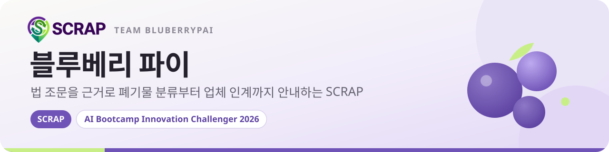

<div align="center">



<br>

[](https://app.scrap-ai.org/)


</div>

### SCRAP의 솔루션


법 조문을 근거로 폐기물 분류부터 업체 연결까지의 길을 안내하고, 그 과정을 기록합니다.

중소 제조 사업장의 폐기물을 **분류부터 처리업체 인계까지** 이어 주는 자원순환 네비게이터입니다.
법령 지식이 없는 담당자도 AI 에이전트 **베리**의 문진을 따라가면 폐기물 분류번호를 확정하고, 업체후보 검토를 통해 인계까지 도달할 수 있습니다.

### LLM 활용

SCRAP에는 두 개의 핵심 에이전트가 있습니다. 두 에이전트 모두 **판정과 승인은 하지 않습니다.** 분류번호는 규칙 엔진이 정하고, 반입은 수신 업체가 수락합니다. AI는 말을 이해하고, 근거를 찾고, 비교하는 일을 맡습니다.

<table>
  <tr>
    <th width="50%">🫐 문진 에이전트 · <a href="https://github.com/BluberrypAI/scrap-diagnosis">scrap-diagnosis</a></th>
    <th width="50%">🫐 업체 추천 에이전트 · <a href="https://github.com/BluberrypAI/scrap-route">scrap-route</a></th>
  </tr>
  <tr>
    <td valign="top">
      <b>폐기물이 무엇인지 법 조문 근거로 판정</b><br><br>
      • <b>말 이해</b>: 담당자가 평소 말투로 답하면 사실 후보와 근거 문구를 뽑고, 코드가 질문 목록·원문과 대조한 값만 기록<br>
      • <b>질의응답</b>: "왜 묻나요?", 용어, 판정 근거를 물으면 법령 검색·규칙 근거·용어집·진행 상태 도구로 찾아 출처와 함께 답변<br>
      • <b>질문 다듬기</b>: 다음 질문을 쉬운 문장으로<br>
      • 판정은 조문 근거 YAML 규칙 엔진이 하고, 정답 사례 100건으로 검증
    </td>
    <td valign="top">
      <b>이 물량을 맡길 만한 가까운 업체를 근거와 함께 추천</b><br><br>
      • 서버가 공정 참조·전국 명부에서 후보를 찾고 <b>도로거리순</b>으로 검토<br>
      • <b>사진 관찰</b>: 물량 사진에서 보이는 상태만 기록<br>
      • <b>공개 근거 검토</b>: 업체가 그 소재·공정을 다룬다는 공개 자료 확인<br>
      • <b>물량 대조</b>: 사진·설명과 업체 근거가 맞는지 비교해 가까운 5곳 선정<br>
      • <b>웹 탐색</b>: 공정별 공개 업체 단서를 출처 URL과 함께 조사
    </td>
  </tr>
</table>

### 레포 구성

| 레포 | 역할 |
| --- | --- |
| [scrap-web](https://github.com/BluberrypAI/scrap-web) | 사용자 화면, 지도·3D 시각화 |
| [scrap-server](https://github.com/BluberrypAI/scrap-server) | API 게이트웨이, 인증·회원, 기업 정보, 업체 후보·기업 간 인계 기록, 법정 서식 |
| [scrap-diagnosis](https://github.com/BluberrypAI/scrap-diagnosis) | 폐기물 분류 판정 엔진과 문진 에이전트 |
| [scrap-route](https://github.com/BluberrypAI/scrap-route) | 업체 추천 에이전트: 사진 관찰, 공개 근거 검토, 물량 대조, 웹 탐색 |
| [scrap-infra](https://github.com/BluberrypAI/scrap-infra) | 전체 통합 실행, Azure 리소스 정의 |
| [.github](https://github.com/BluberrypAI/.github) | 팀 공통 규칙, 이슈·PR 템플릿 |

```
scrap-web ──▶ scrap-server ──▶ scrap-diagnosis   (문진 에이전트 · 분류 판정)
                   │       └──▶ scrap-route       (업체 추천 에이전트)
                   └──▶ PostgreSQL
```

### 팀원


<table>
  <tr>
    <td align="center" width="160">
      <a href="https://github.com/Ai-pre">
        <br />
        <b>윤재상</b>
      </a><br />
      Team Leader, KG, AI
    </td>
    <td align="center" width="160">
      <a href="https://github.com/kallin1">
        <br />
        <b>김다인</b>
      </a><br />
      Web Full Stack
    </td>
    <td align="center" width="160">
      <a href="https://github.com/talaria-02">
        <br />
        <b>이규석</b>
      </a><br />
      AI
    </td>
    <td align="center" width="160">
      <a href="https://github.com/leena-0">
        <br />
        <b>이나영</b>
      </a><br />
      RAG
    </td>
  </tr>
</table>
